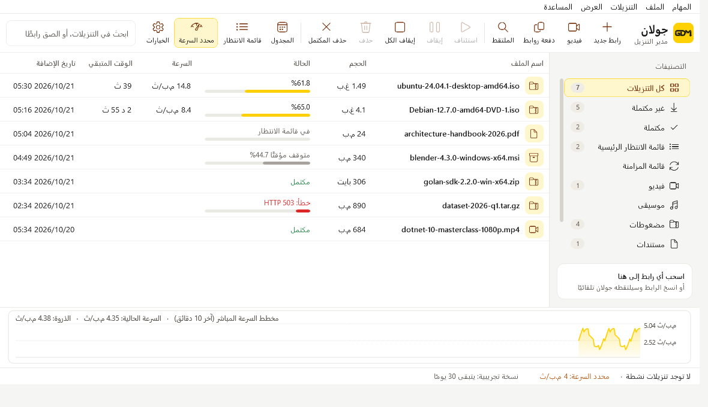
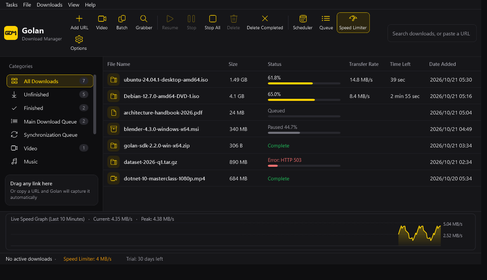
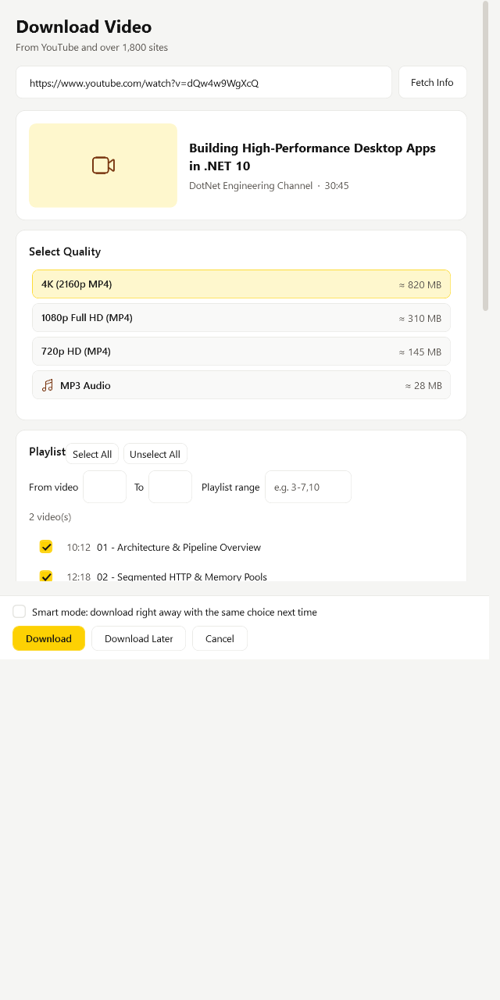

# جولان — مدير التنزيل
### Golan Download Manager (GDM)

**نزّل أسرع، كمّل من حيث توقفت، وما تخسر ملف.**
Fast, resumable downloads for Windows — with browser integration.

---

## العربية

**جولان** مدير تنزيل لويندوز ١٠ و١١، بواجهة عربية وإنكليزية، فاتحة وغامقة.

### المزايا
- **تنزيل متعدد الاتصالات**: يقسّم الملف ويتابع بأقصى سرعة يسمح بها خطّك، ويخفّف الاتصالات تلقائيًا مع المواقع التي ترفض الكثير منها.
- **استئناف موثوق**: أوقف التنزيل أو أغلق الجهاز، ويكمل جولان من حيث توقف. قبل المتابعة يتحقق من أن الملف هو نفسه على الخادم، فلا يخلط نسختين أبدًا.
- **تحديث عنوان التنزيل**: إذا انتهت صلاحية الرابط، اضغط زر التنزيل في الموقع مرة أخرى، فيلتقط جولان الرابط الجديد ويكمل من النسبة نفسها.
- **تكامل مع المتصفحات**: Chrome وEdge وBrave وOpera وVivaldi وFirefox. يلتقط التنزيل قبل أن يبدأه المتصفح.
- **تنزيل الفيديو والصوت** من يوتيوب وأكثر من ١٨٠٠ موقع، مع اختيار الجودة والوضع الذكي.
- **قوائم انتظار ومجدول** ومحدد سرعة، وتنزيل الروابط من خدمات سحابية (GitHub وGoogle Drive وDropbox وOneDrive وMediaFire وMEGA).
- **حماية**: يتجنّب طلبات التحقق من الحماية (مثل Cloudflare) ولا يُغرق المواقع بالطلبات، ولا يحفظ صفحة ويب مكان الملف.

### التثبيت
١. نزّل **`GDMSetup.exe`** من [صفحة الإصدارات](https://github.com/dark9guna/golan-download-manager-releases/releases/latest).
٢. شغّله واتبع الخطوات (يعمل مع بدء ويندوز افتراضيًا، ويمكنك تغيير ذلك).
٣. من **المساعدة ← أضف جولان إلى المتصفح** اتبع الدليل لربط المتصفح.

### الترخيص
نسخة تجريبية كاملة لمدة **٣٠ يومًا**، ثم تحتاج مفتاح تفعيل مرتبطًا بجهازك. للحصول على مفتاح، تواصل معنا عبر [المشكلات](https://github.com/dark9guna/golan-download-manager-releases/issues) مع رمز جهازك (من **المساعدة ← التفعيل**).

---

## English

**Golan** is a download manager for Windows 10 and 11, in Arabic and English, light and dark.

- **Multi-connection downloads** that use your full line speed and back off automatically on sites that limit connections.
- **Reliable resume** after pause, crash or restart — the file on the server is verified first, so two versions are never mixed.
- **Refresh download address**: when a link expires, click download on the site again and Golan continues from the same percent.
- **Browser integration** for Chrome, Edge, Brave, Opera, Vivaldi and Firefox — the download is taken before the browser starts it.
- **Video and audio** from YouTube and 1,800+ sites, with quality choice and Smart mode.
- **Queues, scheduler, speed limiter**, and direct links from GitHub, Google Drive, Dropbox, OneDrive, MediaFire and MEGA.

**Install:** download `GDMSetup.exe` from the [latest release](https://github.com/dark9guna/golan-download-manager-releases/releases/latest), run it, then use **Help ▸ Add Golan to my browser**.

**Licence:** full 30-day trial, then a machine-bound activation key. Open an [issue](https://github.com/dark9guna/golan-download-manager-releases/issues) with your machine code (Help ▸ Activation) to get one.

  
  

---

هذا المستودع للتنزيل وملاحظات الإصدارات. الكود المصدري مفتوح بموجب GPL-3.0 في <a href="https://github.com/dark9guna/golan-download-manager">golan-download-manager</a> · This repository hosts the installer and release notes; the source code is open (GPL-3.0) at <a href="https://github.com/dark9guna/golan-download-manager">golan-download-manager</a>. © Khalid
